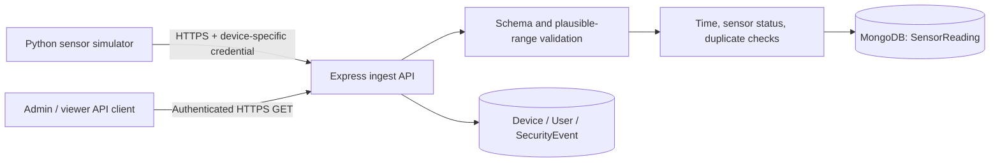
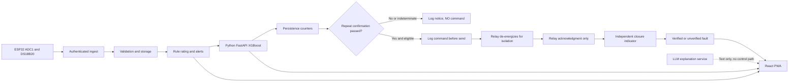

# AquaSentra architecture

## Stage 1 (implemented)

An invalid reading is **not discarded**: it is stored with one or more validity reasons. The canonical uniqueness index is enforced by MongoDB to protect against concurrent duplicate submissions. No independent closure indicator or valve command exists in Stage 1.

## Proposed final architecture (not implemented)

The proposed architecture is conceptual and must be accepted and tested before valve hardware use. Acknowledgment **does not** mean verified closure; only an independent closure sensor can verify it. AI text has **no control path**.

## Sensor/hardware planning (Stage 7)

| Signal | Proposed pin considerations | Critical safety note |
|---|---|---|
| pH PH-4502C/E201-BNC | ESP32 ADC1 | Condition/scaleback any voltage greater than ESP32 ADC limits; hardware calibration needed |
| SEN0189 turbidity | ESP32 ADC1 | Consider 5V sensor output compatibility and voltage divider/buffer |
| TDS Meter V1.0 | ESP32 ADC1 | Compensate for water temperature after empirical calibration |
| DS18B20 | Digital OneWire | Correct voltage/pull-up and waterproof installation |
| Relay + 12V NC valve | Isolated relay output | **Never connect ESP32 GPIO directly to the valve load** |
| Independent closure/flow | Dedicated GPIO/input | Separate verification source, not relay-ack alone |

This is a conceptual wiring list, **not** a final pin map or electrical schematic. Confirm specific module voltage ratings before any deployment.

## Stage 2 extension (implemented)

See [`stage2-architecture.md`](stage2-architecture.md) and [`stage2-acceptance.md`](stage2-acceptance.md). Valid records receive provisional Normal/Risky/Critical rule ratings and, when live eligible and Risky/Critical, a stored alert. Invalid records receive fault notices but no rating; duplicate-only records are flagged without false sensor-fault alerts. React PWA reads authenticated API endpoints from MongoDB. All ML/valve/closure behavior remains unimplemented; closure cannot be inferred from UI contact status.
