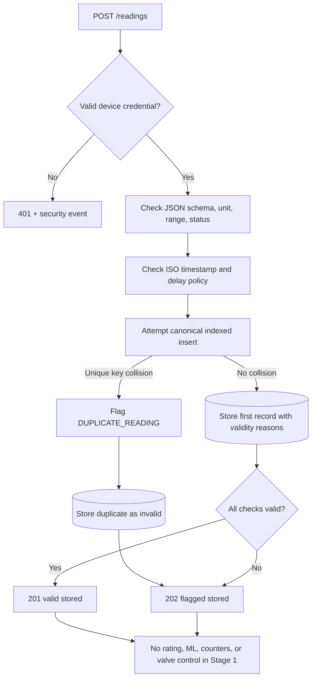

# Stage 1 ingestion decision flow

**Future logic (NOT ACTIVE):** A stored valid reading is not by itself an isolation trigger. A future detection must use past-only model features, designated persistence conditions, a valid repeat-confirmation measurement, and all authorization gates. Authorization must write the command event before transmission. Any failed/invalid confirmation means no command. Relay acknowledgment must not be reported as independent verification of closure.

## Configured Stage 1 timestamp policy (provisional)

- Within ±`timestamp_tolerance_seconds` of receipt: candidate for live processing (if all other checks pass).
- Older than that tolerance, but not older than `max_delayed_record_age_seconds`: store as **valid delayed historical record**, but not eligible for live decisions.
- Future beyond tolerance or older than maximum backfill age: invalid, retained with reason.
- Clock unsynced status: invalid even when numeric timestamp looks plausible.
- Confirmation state, `last_counted_reading` monotonicity, and persistence behavior are reserved for Stage 4.
