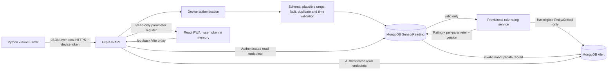

# Stage 2 — architecture, decisions and data safety

**Important:** No command, relay, flow, ML or LLM service is called by this diagram. The flow after storage is solely classification and alert creation.

## Explicit per-reading decision table

| Validity / delay | Rating | Stage 2 action |
|---|---|---|
| Invalid record | Unrated | Save flagged; fault notice if issue other than duplicate-only |
| Valid historical/delayed (not live eligible) | Any | Save overall and individual provisional ratings; no new live alert |
| Valid live eligible | Normal | Save rating; no alert |
| Valid live eligible | Risky | Save rating; log early-warning alert |
| Valid live eligible | Critical | Save rating; log Critical alert immediately |

All thresholds are in `backend/config/parameters.json`. The backend validates band nesting at startup. Parameter version is stored with each assessed reading and alert. Previously rated records are never silently updated after parameter changes. `scripts/backfillRatings.js` only fills previously un-rated valid records without generating retroactive alerts.

## Stores added

`SensorReading`: Stage 1 fields unchanged; Stage 2 adds `rule_details.individual`, `rule_details.temperature_operational_note`, `rule_parameter_set_version`, `rated_at`. `rule_rating` moves from null to `Normal|Risky|Critical` **only for valid readings**.

`Alert`: `{reading_id (unique), device_id, kind, severity, title, message, rating?, codes?, parameter_set_version, occurred_at}` with read-only viewer/admin endpoint.

`Device`: existing `last_seen_at`, interpreted for the UI using provisional `dashboard_offline_after_seconds` (180 sec). This is **not** a fault counter or valve state. The dashboard source model is `not_implemented` and flow state is `unknown`.

## Production gap (not Stage 2 scope)

Access tokens are transmitted only from the local browser to a Vite loopback-only proxy. This isn't a production secure login system. User management, session issuance, request throttling, real certificates, service-to-service TLS and full audit of parameter edits are future work. The app shell may be cached by PWA service worker, but `/api/*`, sensor measurements and credentials are excluded.
