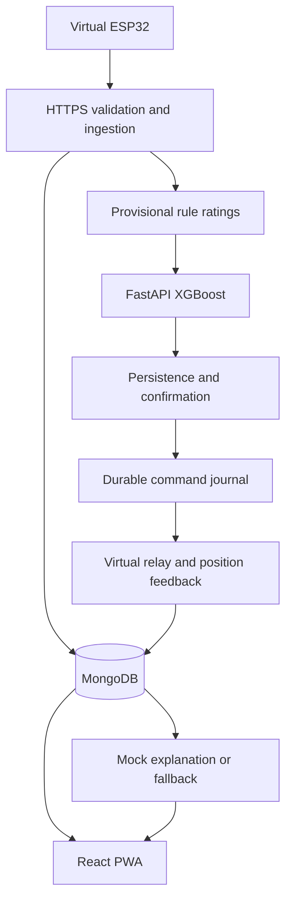
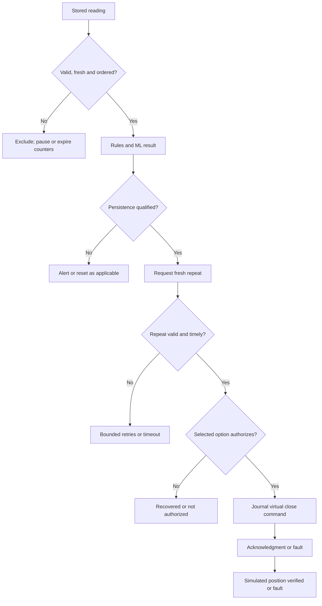

# Integrated software architecture

One Node process serializes control transitions and timer updates. MongoDB stores readings,
AnomalyDetection, ControlState, ValveEvent, Explanation, Alert, Device, User and SecurityEvent.
Rules remain separate from model classifications. All current model features are the four
current measurements (window length 1); no future values, labels or event IDs enter inference.
The Python simulator transmits over local HTTPS. FastAPI listens only on loopback HTTP.
The production frontend is served through the loopback Vite preview proxy; its five-second
polling is near-real-time, not a push stream. Event journal polling is every three seconds.

Commands are journaled before a saved state can reach the virtual timer. Acknowledgment and
position verification have separate timestamps/events. Position feedback is generated by a
software simulation, not a physical sensor. An interrupted journal/state write can leave an
orphan intent; this single-process prototype does not provide transactional exactly-once
recovery or multi-instance control. Do not deploy multiple backend instances against one DB.

Explanations read snapshots, produce text, and have no imported control API or execution tools.
The mock is a deterministic template, not a trained language model. Its unavailable mode returns
a fixed fallback. Every explanation is stored separately.

## Decision flow

## Decision table and chosen assumptions

The source is the supplied Chapter 3, Table 3-6 (pages 23–25). It leaves A/B and numeric
parameters unresolved. This implementation chooses **Option A**, retaining configurable B.
No claimed adviser approval is implied by the demo configuration.

| Rule / model | Notice and persistence | Virtual isolation |
|---|---|---|
| Normal / Normal | Reset ML and Critical counts | None |
| Normal / Anomalous | Increment ML count; request repeat at K | Never under A, even after confirmation |
| Risky / Normal | Immediate reference warning | None |
| Risky / Anomalous | Increment ML count; repeat at K | Fresh repeat Anomalous and at least Risky |
| Critical / Normal | Immediate Critical warning; request repeat; disagreement event | None under A; under B only after K_c and repeat remains Critical |
| Critical / Anomalous | Immediate Critical warning; increment both | A: K and confirmed Anomalous plus at least Risky; B can additionally use K_c plus confirmed Critical |
| Invalid / missing / ML unavailable | Exclude; pause up to M, then reset; Tmax expires state | None |
| Delayed, duplicate or out of order | Store history; no live contribution | None |

Confirmation must be measured after its request's not-before time, and arrive before its
deadline. Normal recovery cancels pending confirmation. Invalid repeat retries are bounded.
Simultaneous qualified pathways share one confirmation and issue one command. Unsolicited
repeat records do not increase counters. Missing periods are computed by elapsed server time,
not by repeated UI refreshes. A communication fault never issues a close command.

Restoration is admin-only, requires explicit simulated inspection and fresh Normal rule/model
results, no pending confirmation, and no active injected fault. Re-arm holdoff clears counts;
new qualifying records are required after holdoff. Startup is de-energized with unknown verified
state until inspection/restoration. Power loss sets the simulated position closed but does not
invent a commanded, acknowledged or independently verified state.

All timing and count choices are in `backend/config/control.json`. Demo values are K=3,
K_c=3, M=2, Tmax=180 seconds, repeat wait=2 seconds, timeout=30 seconds, retries=2,
offline N=3 at 60-second nominal sampling, holdoff=10 seconds, ack timeout=4 seconds,
position timeout=8 seconds. Simulated acknowledgment occurs at 1 second and simulated
position feedback at 2 seconds. These accelerated settings are not measured hardware timing.
Version control parameters when changing them. Restart the backend; do not change them midway
through an evaluated run. ML threshold is selected on validation data and stored with the model
in `ml/artifacts/metrics.json`; modify and retrain `ml/train.py` for another evaluated threshold.
