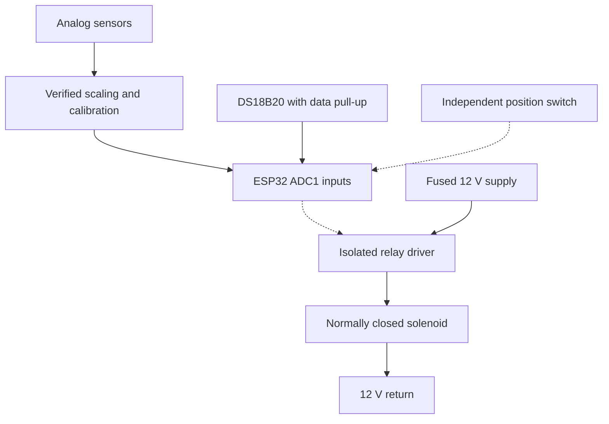

# Future wiring plan — no physical test performed

The firmware build is intentionally virtual-only: it sends synthetic measurements, polls for
confirmation requests, buffers 24 records in RAM, retries with original timestamps, and never
configures an output GPIO. It requires a trusted HTTPS CA; it never disables TLS verification.
The following pin choices are a proposed ESP32 DevKit plan, not a verified assembly schematic.

| Component | Proposed signal | Required validation before hardware implementation |
|---|---|---|
| pH module | ADC1 GPIO34 | Actual module output, voltage scaling, pH 4/7/10 calibration |
| Turbidity module | ADC1 GPIO35 | Actual output range, divider/buffer, NTU calibration |
| TDS module | ADC1 GPIO32 | Module units, scaling, calibration and temperature compensation |
| DS18B20 | GPIO4 | 3.3 V data pull-up, waterproofing and probe verification |
| Isolated relay input | GPIO26, unused in this build | Active polarity, boot pull-down, isolation and current ratings |
| Independent position switch | GPIO27, unused in this build | Mechanical independence and debouncing |
| NC valve supply | External 12 V supply through relay NO contact | Continuous duty, fuse, suppression and ratings |

Dashed paths are future integration only. GPIO must never power the valve coil. In the intended
energize-to-open circuit, relay NO contacts close to supply the valve; removing power closes
the NC valve, subject to actual mechanical behavior. Confirm coil suppression and relay module
isolation against purchased datasheets. A relay acknowledgment cannot prove closure or flow.
No direct electrical connection to a household water system is part of this deliverable.

Future work must replace synthetic acquisition with calibrated sensors and build a separately
reviewed authenticated device-command/acknowledgment interface. The current server deliberately
offers no physical actuator transport. RAM-buffered records are lost on reset; flash persistence,
watchdog policy and calibrated hardware drivers remain future hardware tasks.
